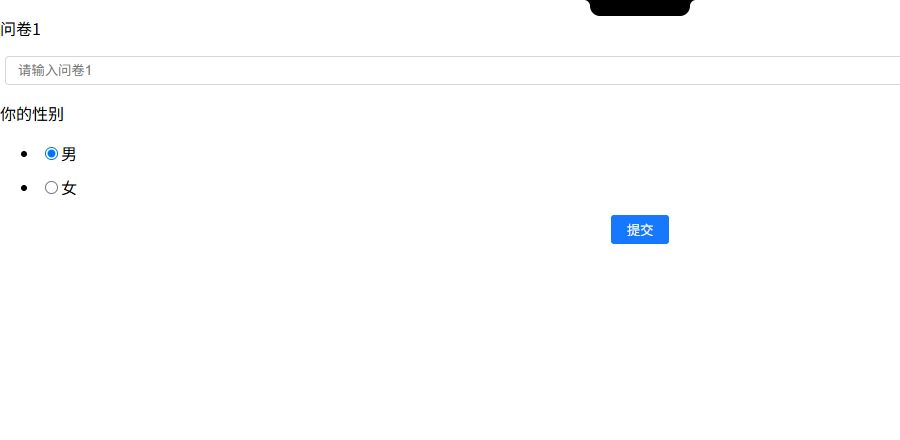
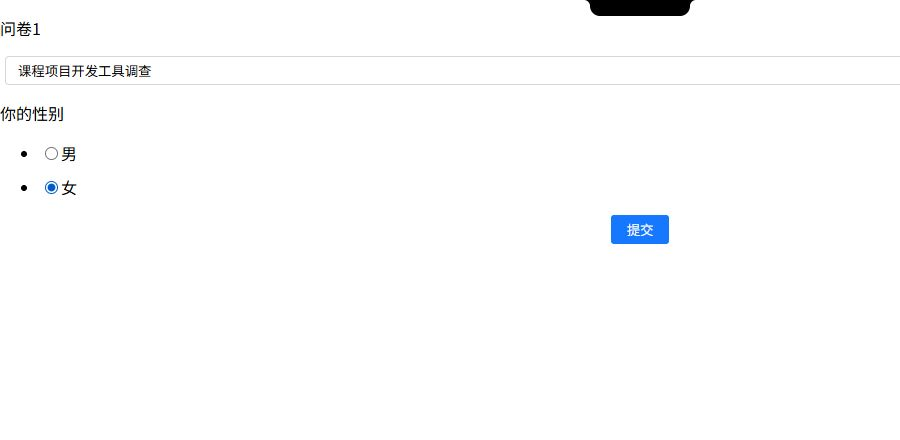

**简体中文** | [English](./readme-en.md)

<p align="center">
  
</p>

<div align="center">

# 问卷星 · C 端

<p><strong>面向问卷填写者的轻量前端原型</strong></p>

<p>
  <a href="https://github.com/tuolola/qustion-star-c"></a>
  <a href="https://gitee.com/guolola/qustion-star-c"></a>
</p>

<p>
  
  
  
  
</p>

</div>

## 项目简介

使用 Next.js App Router、React 与 TypeScript 编写的问卷填写端早期原型。当前源码在 `/question/[id]` 展示示例问卷，包含文本输入与单选题组件，适合作为学习和继续开发的起点。


## 界面预览

以下是本仓库 Next.js 页面在本机运行后的实际截图，访问路径为 `/question/demo`。截图保留原有页面样式，未增加源码中不存在的设计元素。

### 初始填写页面



页面包含一个文本框、一组单选题和提交按钮。题目是源码中的固定示例。

### 输入与切换选项



演示输入框和单选项的本地交互；没有提交真实个人信息，也不表示后端已经保存答卷。

## 核心能力

| 模块 | 说明 |
| --- | --- |
| 问卷路由 | 通过动态路由接收问卷标识，并写入隐藏字段。 |
| 文本输入 | 提供带题目与占位提示的输入组件。 |
| 单选题 | 提供选项及横向、纵向排列配置。 |
| 样式组织 | 使用 CSS Modules 管理题目和页面样式。 |

## 快速开始

准备与仓库锁定的 Next.js 15 依赖兼容的 Node.js 环境。

```bash
git clone https://github.com/tuolola/qustion-star-c.git
cd qustion-star-c
npm ci
npm run dev
```

访问 `http://localhost:3000/question/demo`。当前源码没有根路径 `src/app/page.tsx` 首页，请直接打开问卷路由。

## 项目结构

| 目录 / 文件 | 职责 |
| --- | --- |
| `src/app/question/[id]/` | 示例问卷页面与页面样式 |
| `src/components/QuestionInput/` | 文本输入组件 |
| `src/components/QuestionRadio/` | 单选题组件 |
| `src/app/layout.tsx` | 应用根布局 |

## 常用命令

| 命令 | 用途 |
| --- | --- |
| `npm run dev` | 启动开发服务器 |
| `npm run build` | 生成生产构建 |
| `npm run start` | 启动已构建的生产服务 |

## 当前范围与配置

示例题目目前写在页面中；表单 action 为空，尚未实现提交接口、持久化和结果页。收集真实答卷前，需要接入后端并补充提交校验。原有 `lint` 脚本调用 `next lint`，与当前框架版本的兼容性需另行调整。配套 [B 端编辑器](https://github.com/tuolola/questionnaire-star---react) 是独立前端，本仓库没有提供两端共用的完整后端。


## 当前适合用来做什么

这是一个足够小的填写端起点：动态问卷路由、两种题目组件和一个提交按钮。可以直接从源码看清“页面如何取得问卷 ID—题目如何渲染—样式如何拆分”的过程，再按自己的后端协议继续扩展。

| 场景 | 当前能看到什么 | 继续使用前需要完成什么 |
| --- | --- | --- |
| 学习 Next.js 动态路由 | `/question/[id]` 页面 | 根据实际版本整理路由参数类型 |
| 编写基础题型 | 输入框与单选组件 | 为输入值、校验和序列化定义协议 |
| 与问卷编辑器配套 | 独立 C 端源码 | 接入读取接口，支持 B 端输出的题型 |
| 收集真实答卷 | 当前没有完整链路 | 实现提交、持久化、结果页和服务端验证 |

## 页面与组件详解

### 动态问卷页

页面文件位于 `src/app/question/[id]/page.tsx`。例如访问 `/question/demo` 时，页面使用 `demo` 作为问卷标识，并写入名为 `questionId` 的隐藏字段。

当前页面没有根据 ID 请求题目数据；不同 ID 仍会展示同一组写在源码中的示例题目。要支持真实问卷，应在这里接入读取接口并处理不存在、未发布和访问受限等状态。

### 文本输入组件

`QuestionInput` 接收组件标识、题目标题和占位提示，使用 CSS Modules 管理输入区域样式。

```tsx
<QuestionInput
  fe_id="tool"
  props={{ title: '你常用的开发工具是什么？', placeholder: '请输入工具名称' }}
/>
```

这个示例展示组件调用方式。当前内部文本框还没有用 `fe_id` 设置表单字段名，也没有收集受控答案状态；接入提交逻辑时需要补齐。

### 单选题组件

`QuestionRadio` 接收选项数组、默认值和排列方式。内部 radio 使用 `fe_id` 作为同组字段名，默认选中值由 `value` 决定。

```tsx
<QuestionRadio
  fe_id="role"
  props={{
    title: '你主要使用哪种开发方式？',
    options: [
      { value: 'frontend', text: '前端开发' },
      { value: 'fullstack', text: '全栈开发' }
    ],
    value: 'frontend',
    isVertical: true
  }}
/>
```

单选框使用 `defaultChecked` 初始化显示。若以后支持问卷切换、草稿恢复或动态更新，需明确默认值与当前答案的同步方式。

## 数据流与两端衔接

```text
访问 /question/:id
       │
       ▼
动态路由页面读取 ID
       │
       ├── 当前：渲染源码中的固定题目
       └── 后续：调用问卷读取接口
                 │
                 ▼
          按题型映射到组件
                 ▼
          收集、校验和序列化答案
                 ▼
          提交接口 → 保存 → 结果反馈
```

后半段是继续开发需要补齐的链路，不是当前已经存在的提交实现。

### 与 B 端联调前的检查表

| 项目 | 需要约定的内容 |
| --- | --- |
| 问卷状态 | 哪些问卷允许读取，未发布或已结束如何反馈 |
| 组件标识 | `fe_id` 如何在题目和答案之间对应 |
| 题型协议 | B 端 `type` 与 C 端组件映射关系 |
| 属性协议 | 标题、选项、默认值、必填及校验规则 |
| 提交协议 | 请求结构、幂等处理、错误提示与成功结果 |
| 页面逻辑 | 多页、条件显示和跳转规则由谁执行 |
| 统计口径 | 哪些答案进入统计、如何处理草稿与重复提交 |

配套 B 端注册了更多题型，当前 C 端只有文本输入和单选两个实现。接入时应先支持一个最小可验证的问卷，不要直接把所有 B 端组件视为可填写。

## 本地查看与验证步骤

1. 按快速开始安装锁定依赖并启动开发服务。
2. 打开 `/question/demo`，确认文本框和两个单选项出现。
3. 输入示例文本，切换单选项，检查页面交互。
4. 修改题目标题或占位提示，确认开发热更新。
5. 接入后端后，另行验证答案提交与持久化。当前提交按钮没有完整接口，不能作为收集成功的判断依据。

建议先用非个人信息的演示内容进行开发。当前页面标题仍保留创建模板的默认元数据，正式上线前应根据问卷内容补充标题、描述和页面语言。

## 继续开发的建议顺序

| 顺序 | 工作 | 可以验收的结果 |
| --- | --- | --- |
| 1 | 读取真实问卷 | 不同 ID 返回对应题目，找不到时有明确反馈 |
| 2 | 答案状态管理 | 每个组件有唯一答案位置，可序列化 |
| 3 | 必填与格式校验 | 错误定位到题目，并保留已填写内容 |
| 4 | 提交与持久化 | 后端确认保存，界面显示明确结果 |
| 5 | 支持更多题型 | 与 B 端协议一致，有实际填写示例 |
| 6 | 完善体验 | 键盘操作、窄屏布局、加载与异常状态 |

以上是后续实施建议，不表示仓库已经完成这些能力。

## 常见问题

### 根地址为什么没有首页？

源码中没有 `src/app/page.tsx`，当前入口是 `/question/[id]`。开发时直接打开 `/question/demo` 即可看到示例。

### 更换问卷 ID，题目为什么没有变化？

当前题目直接写在路由页面里，尚未接入按 ID 读取的 API。ID 目前主要用于隐藏字段。

### 点击提交后为什么没有保存提示？

表单没有实现完整提交处理与后端接口。需要自行增加答案收集、验证、请求与结果反馈。

### `npm run lint` 为什么需要调整？

仓库脚本仍使用 `next lint`，但依赖已经锁定在 Next.js 15。现有工具配置需要单独整理，不能把脚本存在当作已通过检查。

### 首次运行需要联网吗？

安装依赖需要访问包源；根布局使用 `next/font/google`，首次开发编译可能还需要下载字体。受限网络中应检查字体下载反馈，正式部署时可评估改用本地字体。

## 视觉标识

青绿色问卷纸张、勾选符号与星芒，表达填写者完成问卷的过程。

## 许可证与第三方材料

原仓库未提供项目根级许可证。公开仓库本身不等于授予通用开源许可；使用、修改或分发前，请联系维护者确认授权。第三方源码、SDK、字体及资源继续遵循各自附带的许可证。
