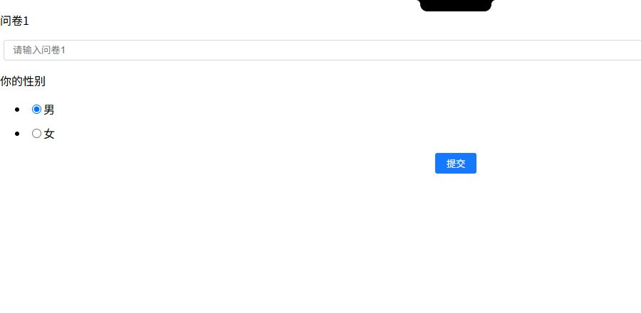
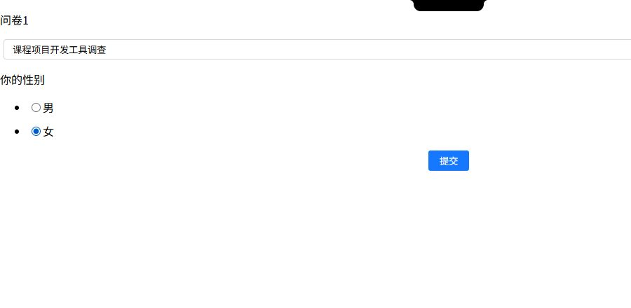

[简体中文](./README.md) | **English**

<p align="center">
  
</p>

<div align="center">

# Questionnaire Star · Respondent

<p><strong>A small starting point for the survey respondent experience</strong></p>

<p>
  <a href="https://github.com/tuolola/qustion-star-c"></a>
  <a href="https://gitee.com/guolola/qustion-star-c"></a>
</p>

<p>
  
  
  
  
</p>

</div>

## Overview

An early questionnaire respondent frontend built with Next.js App Router, React and TypeScript. The current source renders a questionnaire page at `/question/[id]` with sample text-input and single-choice fields. It is a learning and development prototype, rather than a complete survey delivery service.

## Capabilities

| Area | Scope |
| --- | --- |
| Question route | Dynamic questionnaire route with a hidden questionnaire ID. |
| Text input | A reusable input field with a title and placeholder. |
| Single choice | Radio options with vertical or horizontal layout properties. |
| Scoped styles | CSS Modules keep question and page styles organized. |

## Quick Start

Use a Node.js version compatible with the pinned Next.js 15 dependency.

```bash
git clone https://github.com/tuolola/qustion-star-c.git
cd qustion-star-c
npm ci
npm run dev
```

Open `http://localhost:3000/question/demo`. There is no root `src/app/page.tsx` homepage in the current source; start with the questionnaire route.

## Repository Layout

| Path | Responsibility |
| --- | --- |
| `src/app/question/[id]/` | Sample questionnaire page and page styles |
| `src/components/QuestionInput/` | Text-input component |
| `src/components/QuestionRadio/` | Single-choice component |
| `src/app/layout.tsx` | Root application layout |

## Common Commands

| Command | Purpose |
| --- | --- |
| `npm run dev` | Start development server |
| `npm run build` | Create production build |
| `npm run start` | Serve a completed production build |

## Current Scope and Configuration

The sample fields are currently hardcoded. The form has an empty action and no implemented submission API, persistence or results page. Connect a backend and add submission validation before collecting real responses. The existing `lint` script invokes `next lint`; its compatibility with the pinned framework needs a separate tooling update. The companion [builder repository](https://github.com/tuolola/questionnaire-star---react) is a separate frontend; a shared end-to-end backend is not included here.

## Visual Identity

A teal survey sheet, a clear check mark and a small star represent the respondent completing a form.

## License and Third-Party Material

The source repository does not provide a project-level root license. Public visibility alone does not grant a general open-source license; confirm permission with the maintainer before reuse or redistribution. Third-party code, SDKs, fonts and assets retain their own included licenses.

## Interface Preview

Screenshots were captured from the source running locally. Temporary fixture responses were used for the builder and animation workspace; no cloud generation or AE synchronization was executed. Home/statistics numbers in the builder are demonstration values. See the [complete Chinese guide](README.md) for workflows, data contracts, configuration and troubleshooting.





